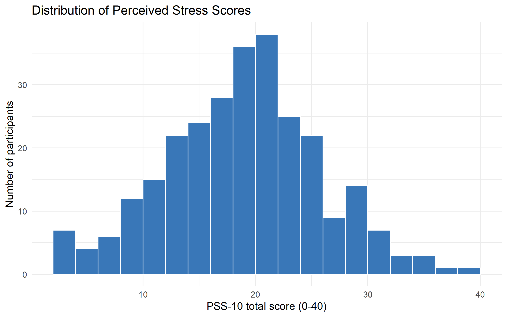
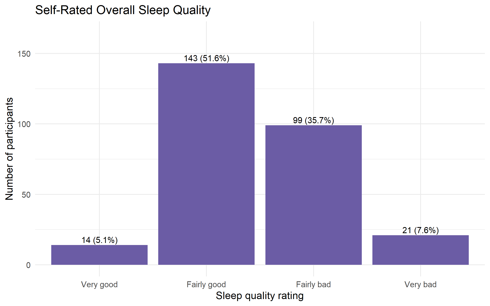
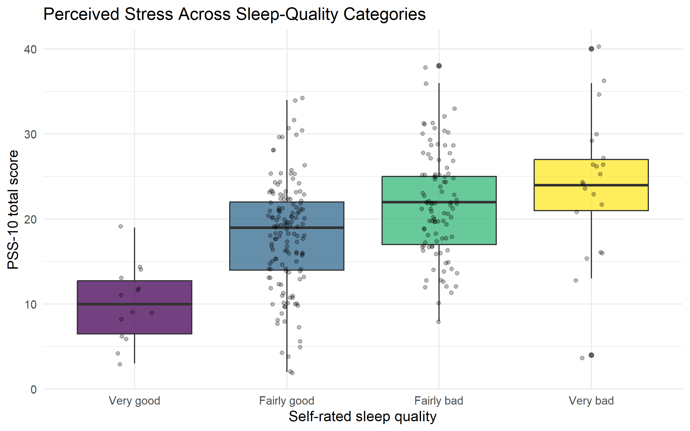

```{r setup, include=FALSE}
knitr::opts_chunk$set(echo = TRUE, warning = FALSE, message = FALSE)
library(readr)
library(dplyr)
library(ggplot2)
knitr::opts_knit$set(root.dir = "..")
```

# Abstract

This project investigates the association between perceived stress and self-rated overall sleep quality using a publicly available survey dataset archived by the University of New England. The dataset includes responses to the Perceived Stress Scale (PSS-10) and the Pittsburgh Sleep Quality Index (PSQI). The analysis uses completed survey records, calculates a PSS-10 total score using reverse scoring for positively worded items, and treats the overall sleep-quality response as an ordinal outcome. Descriptive statistics, visualisations, Spearman rank correlation and ordinal logistic regression are used. The study is observational and cross-sectional; therefore, findings describe associations and cannot establish that stress causes changes in sleep.

# 1. Introduction

Stress and sleep are important aspects of health and wellbeing. Psychological stress may be associated with difficulty falling asleep, disrupted sleep and poorer subjective sleep quality. Understanding this relationship is relevant to health promotion because sleep and stress can influence daily functioning and quality of life.

The present project uses an existing research dataset rather than collecting new participant information. The aim is to investigate whether higher perceived stress scores are associated with poorer self-rated sleep quality.

**Research question:** Is perceived stress associated with self-rated overall sleep quality among participants who completed the survey?

**Null hypothesis (H0):** There is no statistically significant monotonic association between perceived stress and self-rated sleep quality.

**Alternative hypothesis (H1):** There is a statistically significant monotonic association between perceived stress and self-rated sleep quality.

# 2. Dataset

The dataset, *The Relationship Between Stress, Arousal, Sleep Quality & Affective Symptoms*, was published by Jamieson, Brown and Roche-Freedman (2022) and archived by the University of New England. The repository describes an online Qualtrics survey completed by 286 participants. The workbook contains demographic information, psychological diagnosis questions, PSS items, pre-sleep arousal items, insomnia-related measures, PSQI items, DASS-21 items and lifestyle questions.

The supplied spreadsheet export contains an embedded question-label row. The R script skips that row before analysis. The export includes completed and incomplete submissions; the script identifies records marked as finished and calculates the final usable sample after checking missing values in the selected measures. Therefore, the analysis sample is determined from the supplied workbook rather than assumed to equal the repository's abstract count.

Only the ten PSS items (`Q20_1` to `Q20_10`) and the overall sleep-quality question (`Q46`) are used in the primary analysis. The dataset includes a wider PSQI questionnaire, but this project does not claim to calculate the complete PSQI global score. The selected outcome is the single overall sleep-quality rating.

# 3. Methods

## 3.1 Data import and preprocessing

The Excel workbook was imported using `readxl`. The embedded question wording row was excluded. Only completed records were retained. The analysis checked that all ten PSS item columns and the sleep-quality item were present and that response codes fell within the expected ranges.

Participant identifiers and unrelated sensitive fields were not selected. Participant-level data are not exported by the analysis script or committed to the public repository.

## 3.2 PSS-10 scoring

The PSS-10 consists of ten questions. The scoring implemented here assumes that the exported response codes 1–5 represent increasing frequency from never to very often. These are converted to the standard 0–4 range. Positively worded items 4, 5, 7 and 8 are reverse-scored. The ten items are summed to produce a score from 0 to 40, with higher values indicating greater perceived stress.

This coding assumption must be checked against the original survey response options or codebook. If the response order differs, scoring must be corrected before interpreting results.

## 3.3 Sleep-quality outcome

The overall sleep-quality question (`Q46`) is treated as an ordered categorical variable. The analysis assumes codes 1–4 correspond to very good, fairly good, fairly bad and very bad, respectively. This order must be verified against the original questionnaire. The selected variable is not the full PSQI global score.

## 3.4 Statistical analysis

Descriptive statistics summarise the PSS-10 score and the distribution of sleep-quality categories. Spearman's rank correlation assesses the direction and strength of the monotonic association between stress and ordered sleep quality. Ordinal logistic regression examines whether the PSS-10 score is associated with the odds of reporting a worse sleep-quality category.

A p-value below 0.05 is treated as statistically significant. Statistical significance is not interpreted as proof of causation or clinical importance.

# 4. Results

The following results are generated from the local workbook by `code/01_analysis.R`. They should be regenerated after verifying the questionnaire response coding.

```{r results-summary}
if (!file.exists("results/analysis_run_summary.csv")) {
  stop("Run code/01_analysis.R from the project root before knitting this report.")
}
run_summary <- read_csv("results/analysis_run_summary.csv", show_col_types = FALSE)
knitr::kable(run_summary, caption = "Summary of the analysed dataset and main association")
```

## 4.1 Perceived stress distribution



The histogram displays the distribution of perceived stress scores among participants with complete selected measures. A higher PSS-10 total indicates greater perceived stress under the scoring assumptions described above.

## 4.2 Sleep-quality distribution



The bar chart presents the number of participants in each self-rated sleep-quality category.

## 4.3 Stress by sleep-quality category



The boxplot compares perceived stress scores across the four ordered sleep-quality categories. The pattern should be interpreted together with the correlation and regression results.

## 4.4 Statistical tests

```{r statistical-results}
if (file.exists("results/spearman_correlation.txt")) {
  cat(paste(readLines("results/spearman_correlation.txt"), collapse = "\n"))
}
if (file.exists("results/ordinal_logistic_regression.txt")) {
  cat("\n\nOrdinal logistic regression:\n")
  cat(paste(readLines("results/ordinal_logistic_regression.txt"), collapse = "\n"))
}
```

The Spearman coefficient indicates the direction and strength of the rank association. Under the assumed coding, a positive coefficient means higher stress scores tend to occur with higher Q46 values, which represent poorer sleep. The ordinal model provides a complementary estimate of the association.

# 5. Discussion

The analysis addresses whether perceived stress is associated with self-rated sleep quality in this survey sample. The results should be interpreted using the observed coefficient, p-value, sample size and category distribution generated by the R script. If the association is statistically significant and positive under the assumed coding, this would be consistent with higher perceived stress accompanying poorer self-rated sleep. If it is not significant, the analysis does not provide sufficient evidence of an association in this sample; it does not prove that no relationship exists.

Several limitations are important. First, the data are cross-sectional, so temporal order and causality cannot be established. Poor sleep may contribute to stress, stress may contribute to poor sleep, or both may be influenced by other factors. Second, both measures are self-reported and may be affected by recall or response bias. Third, the analysis uses the overall sleep-quality item rather than calculating the full PSQI global score. Fourth, the PSS response coding and the Q46 category order must be checked against the original survey instrument before final interpretation. Finally, the usable analysis sample may be smaller than the participant count stated in the dataset abstract because incomplete records are excluded.

Future work could calculate the complete PSQI global score using all required components and validated scoring rules, examine demographic or lifestyle covariates, and replicate the analysis in an independent sample.

# 6. Conclusion

This project demonstrates a reproducible R workflow for examining a health-related research question using a publicly archived survey dataset. It imports and checks real research data, applies documented questionnaire scoring assumptions, visualises the selected measures and uses non-parametric correlation and ordinal regression. The final conclusion must be based on the generated statistical results and should remain limited to association rather than causation.

# 7. Reproducibility

Run the project from the repository root. Place the original workbook in `data/raw/` locally, run `code/01_analysis.R`, and then knit this report. Required R packages are `readxl`, `dplyr`, `tidyr`, `ggplot2`, `readr`, `MASS`, `rmarkdown` and `knitr`. The raw workbook and participant-level records are excluded from GitHub.

# 8. References

Jamieson, G., Brown, R., & Roche-Freedman, K. (2022). *The Relationship Between Stress, Arousal, Sleep Quality & Affective Symptoms* [Dataset]. University of New England. https://doi.org/10.25952/ydqq-kr29

Cohen, S., Kamarck, T., & Mermelstein, R. (1983). A global measure of perceived stress. *Journal of Health and Social Behavior, 24*(4), 385–396.

Buysse, D. J., Reynolds, C. F., Monk, T. H., Berman, S. R., & Kupfer, D. J. (1989). The Pittsburgh Sleep Quality Index: A new instrument for psychiatric practice and research. *Psychiatry Research, 28*(2), 193–213.
